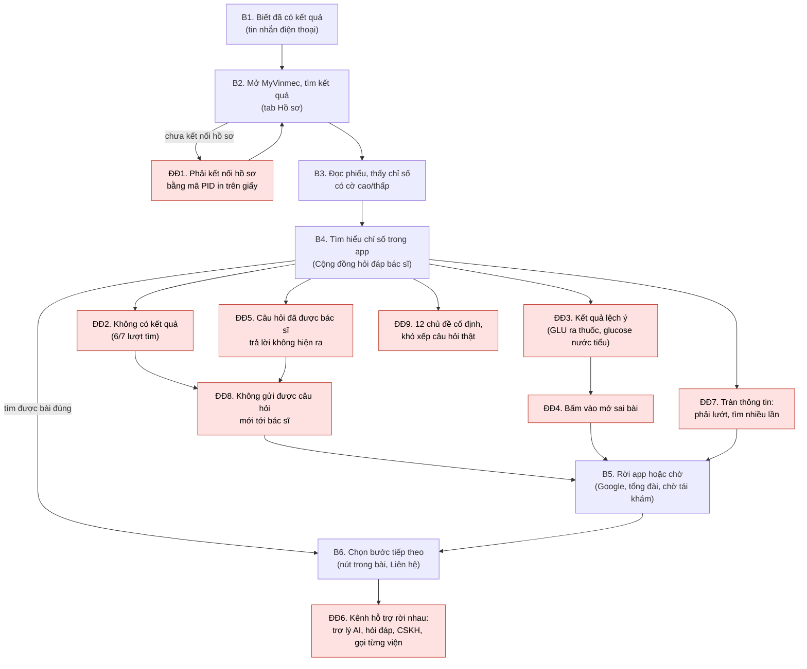

# Workflow: tìm hiểu một chỉ số trên phiếu kết quả qua MyVinmec

Trạng thái: BẢN v3 TỪ QUAN SÁT APP VÀ PHỎNG VẤN P01-P03. Đề cho phép chọn journey map (kèm cảm xúc) hoặc workflow; bài dùng workflow vì điểm đau chính nằm ở các bước thao tác trong app. Cột cảm xúc lấy từ phiếu P01-P03 (diễn ý, ứng viên bổ sung ngày 19/10/2026 theo từng câu trong guide).

- Khoảnh khắc: Nhận kết quả.
- Điểm bắt đầu: người bệnh biết đã có kết quả xét nghiệm.
- Điểm kết thúc: người bệnh hiểu chỉ số mình thắc mắc ở mức đủ để biết bước tiếp theo (hỏi bác sĩ, đặt tư vấn, hay chỉ lưu lại).
- Nguồn: [nhật ký quan sát](../01-phong-van/myvinmec-observation.md) (O1-O10, O6b, kiểm thử tìm kiếm ngày 19/10/2026), phỏng vấn [P01-P03](../01-phong-van/interviews/) (cả ba khám tại Vinmec Ocean Park 2), trang hướng dẫn của Vinmec về theo dõi kết quả, và 11 trang nội dung trên vinmec.com mở trực tiếp ngày 19/10/2026.

## Sơ đồ

Ô đỏ là điểm đau. B3 chưa quan sát được trong app vì tài khoản chưa kết nối hồ sơ (O5); phỏng vấn mô tả B3 trên phiếu giấy. Theo phỏng vấn, câu hỏi ở B4 là về vấn đề sức khỏe sau khám nói chung, chỉ số xét nghiệm chỉ là một phần, và thường nảy ra sau khi đã gặp bác sĩ (I05, I09, I11).

## Các bước

| Bước | Mục tiêu của người bệnh | Hành động | Điểm chạm | Cảm xúc và căn cứ | Điểm đau | Bằng chứng | Cơ hội |
|---|---|---|---|---|---|---|---|
| B1 | Biết kết quả đã có | Nhận tin nhắn, chờ tại viện hoặc nghe bác sĩ nói trực tiếp | Tin nhắn điện thoại, quầy trả kết quả, phòng khám | Không ghi nhận cảm xúc riêng ở bước này; P03 yên tâm lúc khám (P03-10) | | Trang hướng dẫn của Vinmec: hồ sơ xong thì gửi tin nhắn; P01-06, P01-07, P02-07, P02-08, P03-06 | |
| B2 | Mở được kết quả | Nhận phiếu giấy tại quầy; chưa xem trong app | Phiếu giấy, phim; app, mã PID in trên voucher hoặc bảng kê | Không ghi nhận cảm xúc riêng ở bước này; P01 muốn kết quả hiện trong app (P01-18) | ĐĐ1 | O4: đơn thuốc và sổ tiêm đều yêu cầu kết nối hồ sơ; P01-06: tài khoản chưa kết nối hồ sơ; P02-07: không xem kết quả trên app | Không thuộc phạm vi prototype |
| B3 | Hiểu phiếu nói gì | Đọc các cột, ký hiệu, phần kết luận | Phiếu giấy (trong app: chưa quan sát) | Lo khi thấy dòng có đánh dấu (P01-10); hoang mang vì thuật ngữ trong kết luận (P02-11); đỡ hơn sau khi gặp bác sĩ (P02-11) | Không hiểu chữ viết tắt, đơn vị, khoảng tham chiếu, thuật ngữ | P01-08, P01-09, P02-09, P02-10; O5: chưa xem được trong app | Giải thích ngay trên dòng chỉ số có cờ |
| B4 | Có câu trả lời cho câu hỏi về kết quả hoặc vấn đề sức khỏe sau khám | Gõ tìm trong Cộng đồng hỏi đáp bác sĩ (chữ viết tắt, thuật ngữ, tên chung, cả câu); lướt danh sách | Ô tìm kiếm, danh sách hỏi đáp theo chủ đề | Khi kể lại: từ vui vẻ chuyển dần sang khó chịu (P01-05, P02-06, P03-05); lo khi có biểu hiện mới giữa hai lần tái khám (P03-10) | ĐĐ2, ĐĐ3, ĐĐ4, ĐĐ5, ĐĐ7, ĐĐ8, ĐĐ9, ĐĐ10 | O6, O6b, bảng kiểm thử tìm kiếm; P01-01, P01-11, P02-01, P02-02, P02-12, P03-01, P03-11 | Đưa người hỏi tới đúng nội dung bác sĩ đã viết; khi chưa có thì cho gửi câu hỏi |
| B5 | Có câu trả lời | Tìm trên Google; gọi tổng đài; chờ tái khám | Ngoài app, tổng đài | Không chắc bài nào đúng cho mình (P01-12, P02-14); P03 không ghi nhận | Nguồn ngoài chưa chắc đúng trường hợp của mình; tổng đài đưa về đặt lịch | P01-12, P02-14, P03-13 (I12) | Câu trả lời từ bác sĩ Vinmec ngay trong app |
| B6 | Biết làm gì tiếp | Theo lời dặn của bác sĩ; bấm nút trong bài hoặc vào Liên hệ | Lời dặn khi khám; nút "Tư vấn với bác sĩ", "Đăng ký khám"; Liên hệ | Không chắc khi nào cần quay lại sớm (P02-16, P03-15) | ĐĐ6 | O7, O9; P01-14, P02-16, P03-15 | Từ câu hỏi đi thẳng tới kênh phù hợp |

## Phân tích điểm đau

| ID | Điểm đau | Bằng chứng | Loại | Mức chắc chắn | Cần AI? |
|---|---|---|---|---|---|
| ĐĐ1 | Muốn xem dữ liệu cá nhân phải kết nối hồ sơ bằng mã PID in trên giấy tờ | O4 (đơn thuốc, sổ tiêm); P01-06: tài khoản chưa kết nối nên không xem được kết quả trong app | Quy trình | Trung bình: chưa thấy trực tiếp với màn hình kết quả; 1/3 người xác nhận | Không |
| ĐĐ2 | Câu hỏi đời thường không ra kết quả: "men gan cao", "đường huyết lúc đói cao", "ALT", "duong huyet cao"; cả ba người được phỏng vấn tìm câu hỏi về sức khỏe của mình và không thấy kết quả | Bảng kiểm thử: 6/7 lượt không có kết quả, lặp lại ở lượt 2; P01-01, P02-01, P03-01 | Tìm kiếm | Cao: có cả quan sát lẫn lời 3/3 người được phỏng vấn | Một phần: chuẩn hóa dấu và từ đồng nghĩa không cần AI; câu hỏi tự nhiên thì cần |
| ĐĐ3 | Chữ viết tắt trên phiếu bị hiểu sai ngữ cảnh: GLU trả về bài thuốc Glucovance và bài glucose nước tiểu, không có bài glucose máu | Bảng kiểm thử, ảnh O6-tim-glu | Tìm kiếm | Cao với từ khóa đã thử | Có: cần hiểu GLU trên phiếu máu là glucose máu |
| ĐĐ4 | Kết quả tìm kiếm mở sai bài ("Công dụng thuốc Glucovance" mở ra "Trẻ 26 tháng tuổi phát triển như thế nào?") | Ảnh O6-glu-ket-qua-1-mo-sai-bai | Dữ liệu | Cao, tái hiện trong lượt thử | Không: lỗi liên kết dữ liệu |
| ĐĐ5 | Câu hỏi đã có bác sĩ trả lời không hiện ra: trên vinmec.com có bài Hỏi/Trả lời "Chỉ số AST, ALT là chỉ số gì?" và "Hướng dẫn đọc kết quả xét nghiệm mỡ máu", nhưng tìm "ALT", "men gan cao" trong app không ra gì | Bảng kiểm thử; hai trang trên vinmec.com mở ngày 19/10/2026 | Tìm kiếm | Trung bình: chưa xác minh hai bài này nằm trong kho dữ liệu của mục Cộng đồng trong app | Có, nếu muốn tìm theo ý nghĩa |
| ĐĐ6 | Kênh hỗ trợ có nhiều nhưng rời nhau; không có lối đi từ một câu hỏi về chỉ số tới kênh phù hợp | O1, O6, O7, O9; P03-13: gọi tổng đài thì được khuyên đặt lịch khám | Kiến trúc thông tin | Trung bình: nhận định về thiết kế, 1/3 người kể lại | Một phần |
| ĐĐ7 | Tràn thông tin: phải lướt và tìm nhiều lần mới thấy câu có giá trị | P02-02, P02-12; O6b (danh sách dài, chưa rõ cách sắp xếp, 3 câu đầu chuyên mục Tim mạch đều đề ngày 08/07/2024) | Tìm kiếm, sắp xếp | Thấp đến trung bình: 1/3 người | Có: chọn ra vài câu đúng ngữ cảnh thay vì bắt lướt |
| ĐĐ8 | Không gửi được câu hỏi mới tới bác sĩ trong Cộng đồng hỏi đáp, dù thẻ tên bác sĩ hiện ngay đầu trang | O6b; P02-14, P02-20, P03-17 (I07) | Thiếu chức năng | Thấp đến trung bình: 2/3 người, diễn ý hồi tưởng | Một phần: kênh gửi câu hỏi không cần AI; soạn câu hỏi rõ ràng và chống trùng thì cần |
| ĐĐ9 | Câu hỏi phải nằm trong 12 chủ đề cố định, khó xếp câu hỏi thật | O6b; P03-11, P03-19 (I08) | Kiến trúc thông tin | Thấp đến trung bình: 1/3 người | Một phần |
| ĐĐ10 | Câu hỏi nảy ra sau khi đã gặp bác sĩ (về nhà, khi triệu chứng quay lại, giữa hai lần tái khám), lúc không còn kênh hỏi lại | P01-13, P02-15, P02-16, P03-14, P03-15 (I11) | Thiếu chức năng | Thấp đến trung bình: 3/3 người, nhưng là diễn ý ứng viên hồi tưởng một ngày sau phỏng vấn | Một phần: kênh hỏi lại không cần AI; tìm bài đúng và soạn câu hỏi thì cần |

## Nguyên nhân có thể (suy luận từ hành vi bên ngoài, chưa xem được hệ thống)

1. Tìm kiếm khớp theo chuỗi ký tự trong tiêu đề, không chuẩn hóa dấu và không có từ đồng nghĩa. Căn cứ: "GLU" khớp với "Glucovance" và "glucose"; câu không dấu không ra kết quả.
2. Chỉ mục tìm kiếm không gồm câu hỏi trong kho hỏi đáp, hoặc gồm nhưng xếp hạng kém. Căn cứ: kết quả chỉ nằm trong mục "Kiến thức".
3. Sai lệch giữa tiêu đề và đường dẫn bài trong dữ liệu. Căn cứ: ĐĐ4.
4. Phân loại chuyên khoa chưa nhất quán: thứ hạng 1-2-3 không theo số câu hỏi; Tim mạch nằm ở hai nhóm ([ảnh](../01-phong-van/anh-myvinmec/O6-cong-dong-chuyen-khoa.png)).

Nguyên nhân 3 và 4 sửa được bằng làm sạch dữ liệu, không cần AI. Prototype nhắm vào ĐĐ2, ĐĐ3, ĐĐ5, ĐĐ6, ĐĐ7, ĐĐ8 và ĐĐ10 bằng vòng khép kín (xem `05-prototype/README.md`).
