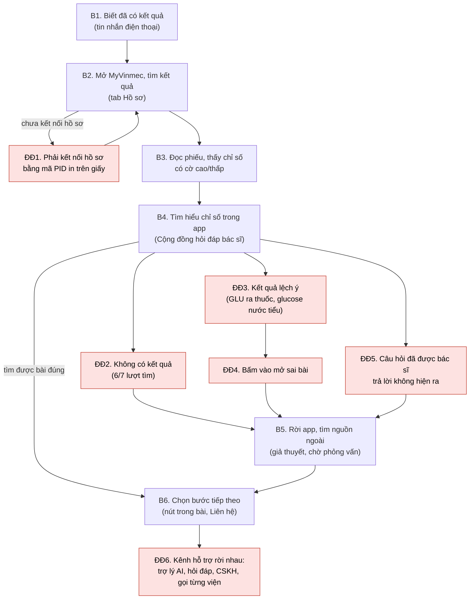

# Workflow: tìm hiểu một chỉ số trên phiếu kết quả qua MyVinmec

Trạng thái: BẢN v1 TỪ QUAN SÁT APP. Cột cảm xúc chờ phỏng vấn P1-P3; đề cho phép dùng workflow thay journey map.

- Khoảnh khắc: Nhận kết quả.
- Điểm bắt đầu: người bệnh biết đã có kết quả xét nghiệm.
- Điểm kết thúc: người bệnh hiểu chỉ số mình thắc mắc ở mức đủ để biết bước tiếp theo (hỏi bác sĩ, đặt tư vấn, hay chỉ lưu lại).
- Nguồn: [nhật ký quan sát](../01-phong-van/myvinmec-observation.md) (O1-O10, kiểm thử tìm kiếm ngày 19/10/2026), trang hướng dẫn của Vinmec về theo dõi kết quả, và 11 trang nội dung trên vinmec.com mở trực tiếp ngày 19/10/2026.

## Sơ đồ

Ô đỏ là điểm đau. B3 chưa quan sát được vì tài khoản chưa kết nối hồ sơ (O5); B5 là giả thuyết.

## Các bước

| Bước | Mục tiêu của người bệnh | Hành động | Điểm chạm | Cảm xúc và căn cứ | Điểm đau | Bằng chứng | Cơ hội |
|---|---|---|---|---|---|---|---|
| B1 | Biết kết quả đã có | Nhận tin nhắn | Tin nhắn điện thoại | [Chờ P1-P3] | | Trang hướng dẫn của Vinmec: hồ sơ xong thì gửi tin nhắn | |
| B2 | Mở được kết quả | Vào tab Hồ sơ, kết nối hồ sơ nếu chưa có | App, mã PID in trên voucher hoặc bảng kê | [Chờ P1-P3] | ĐĐ1 | O4: đơn thuốc và sổ tiêm đều yêu cầu kết nối hồ sơ | Không thuộc phạm vi prototype |
| B3 | Hiểu phiếu nói gì | Đọc các cột, ký hiệu | Màn hình kết quả | [Chờ P1-P3] | Chưa quan sát | O5: chưa xem được | |
| B4 | Hiểu một chỉ số cụ thể | Gõ tìm trong Cộng đồng hỏi đáp bác sĩ | Ô tìm kiếm | [Chờ P1-P3] | ĐĐ2, ĐĐ3, ĐĐ4, ĐĐ5 | O6 và bảng kiểm thử tìm kiếm | Đưa người hỏi tới đúng nội dung bác sĩ đã viết |
| B5 | Có câu trả lời | Tìm trên mạng hoặc hỏi người quen | Ngoài app | [Chờ P1-P3] | Nguồn chưa kiểm chứng | Giả thuyết | |
| B6 | Biết làm gì tiếp | Bấm nút trong bài hoặc vào Liên hệ | Nút "Tư vấn với bác sĩ", "Đăng ký khám"; Liên hệ | [Chờ P1-P3] | ĐĐ6 | O7, O9 | Từ câu hỏi đi thẳng tới kênh phù hợp |

## Phân tích điểm đau

| ID | Điểm đau | Bằng chứng | Loại | Mức chắc chắn | Cần AI? |
|---|---|---|---|---|---|
| ĐĐ1 | Muốn xem dữ liệu cá nhân phải kết nối hồ sơ bằng mã PID in trên giấy tờ | O4 (đơn thuốc, sổ tiêm) | Quy trình | Trung bình: chưa thấy trực tiếp với màn hình kết quả | Không |
| ĐĐ2 | Câu hỏi đời thường không ra kết quả: "men gan cao", "đường huyết lúc đói cao", "ALT", "duong huyet cao" | Bảng kiểm thử: 6/7 lượt không có kết quả, lặp lại ở lượt 2 | Tìm kiếm | Cao với các từ khóa đã thử | Một phần: chuẩn hóa dấu và từ đồng nghĩa không cần AI; câu hỏi tự nhiên thì cần |
| ĐĐ3 | Chữ viết tắt trên phiếu bị hiểu sai ngữ cảnh: GLU trả về bài thuốc Glucovance và bài glucose nước tiểu, không có bài glucose máu | Bảng kiểm thử, ảnh O6-tim-glu | Tìm kiếm | Cao với từ khóa đã thử | Có: cần hiểu GLU trên phiếu máu là glucose máu |
| ĐĐ4 | Kết quả tìm kiếm mở sai bài ("Công dụng thuốc Glucovance" mở ra "Trẻ 26 tháng tuổi phát triển như thế nào?") | Ảnh O6-glu-ket-qua-1-mo-sai-bai | Dữ liệu | Cao, tái hiện trong lượt thử | Không: lỗi liên kết dữ liệu |
| ĐĐ5 | Câu hỏi đã có bác sĩ trả lời không hiện ra: trên vinmec.com có bài Hỏi/Trả lời "Chỉ số AST, ALT là chỉ số gì?" và "Hướng dẫn đọc kết quả xét nghiệm mỡ máu", nhưng tìm "ALT", "men gan cao" trong app không ra gì | Bảng kiểm thử; hai trang trên vinmec.com mở ngày 19/10/2026 | Tìm kiếm | Trung bình: chưa xác minh hai bài này nằm trong kho dữ liệu của mục Cộng đồng trong app | Có, nếu muốn tìm theo ý nghĩa |
| ĐĐ6 | Kênh hỗ trợ có nhiều nhưng rời nhau; không có lối đi từ một câu hỏi về chỉ số tới kênh phù hợp | O1, O6, O7, O9 | Kiến trúc thông tin | Trung bình: nhận định về thiết kế, chưa có lời người dùng | Một phần |

## Nguyên nhân có thể (suy luận từ hành vi bên ngoài, chưa xem được hệ thống)

1. Tìm kiếm khớp theo chuỗi ký tự trong tiêu đề, không chuẩn hóa dấu và không có từ đồng nghĩa. Căn cứ: "GLU" khớp với "Glucovance" và "glucose"; câu không dấu không ra kết quả.
2. Chỉ mục tìm kiếm không gồm câu hỏi trong kho hỏi đáp, hoặc gồm nhưng xếp hạng kém. Căn cứ: kết quả chỉ nằm trong mục "Kiến thức".
3. Sai lệch giữa tiêu đề và đường dẫn bài trong dữ liệu. Căn cứ: ĐĐ4.
4. Phân loại chuyên khoa chưa nhất quán: thứ hạng 1-2-3 không theo số câu hỏi; Tim mạch nằm ở hai nhóm ([ảnh](../01-phong-van/anh-myvinmec/O6-cong-dong-chuyen-khoa.png)).

Nguyên nhân 3 và 4 sửa được bằng làm sạch dữ liệu, không cần AI. Prototype chỉ nhắm vào ĐĐ2, ĐĐ3, ĐĐ5 và ĐĐ6.
